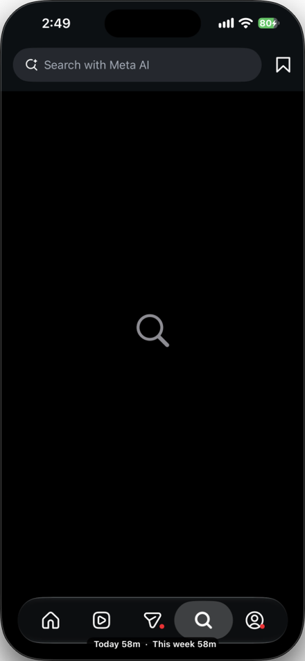

# NotTheInstagram

I couldn't delete Instagram, so I made it boring.

My friends are there, and so are the memes in my DMs. What I wanted gone was the hour that disappears into the feed. This is a small experiment: a framework that gets injected into Instagram on my iPhone, slows down the endless parts and leaves the rest alone.

**[Read how I built it with an AI agent →](https://rationalkunal.in/writing/make-instagram-boring-with-an-ai-agent/)**

<table align="center">
  <tr>
    <td align="center"><br><sub>Home feed, 3 posts at a time</sub></td>
    <td align="center"><br><sub>Reels tab opens on a pause</sub></td>
    <td align="center"><br><sub>Explore without the reel grid</sub></td>
  </tr>
</table>

## What changes

- The home feed shows three posts, then makes you wait. 8 seconds, then 11, then 14.
- The Reels tab opens on a pause screen. Stay on it for two minutes and a "Continue for this session" button appears.
- Inside, each reel waits behind a blur before it plays: 3 seconds, plus half a second for every reel after.
- A reel opened outside the Reels tab, like one a friend sends you, plays alone. No swiping into the next one.
- Explore keeps its search bar and loses the grid.
- A small label at the bottom shows your time on Instagram today and this week.

DMs, stories, posts, profiles and search work like before.

## How it works

A lot of Instagram is written in Objective-C, which looks up the code behind each method while the app is running. Code loaded into the app can swap in its own version and still call the original. The framework does that for a handful of methods:

- When the feed is about to show more posts, it shows three and puts a spinner after them.
- When a reel asks to play, it holds the request behind a blur for a few seconds.
- When the Explore grid lays itself out, it hides the grid.

Before swapping anything, it checks that the method still takes the arguments and returns the type it expects. If an Instagram update changes it, the framework leaves that method alone.

[Sideloadly](https://sideloadly.io/) puts it on the phone. It takes a decrypted Instagram IPA, adds the framework, re-signs the app with your Apple account and installs it. Re-signing cuts the app off from Meta's shared keychain and folders, which logs you out on every launch and crashes Instagram. The framework points those calls to storage the app owns. The [blog post](https://rationalkunal.in/writing/make-instagram-boring-with-an-ai-agent/) has the whole debugging story.

## Try it

You need a Mac with Xcode, an iPhone on iOS 16.3 or later, an Apple account, [Sideloadly](https://sideloadly.io/), and a decrypted Instagram IPA. I can't share the IPA, so you'll need to find one yourself. Everything was built and tested on Instagram 455.0.0. Treat other versions as untested.

1. Build the framework:

   ```bash
   git clone https://github.com/rational-kunal/NotTheInstagram.git
   cd NotTheInstagram
   ./scripts/build-framework.sh
   ```

2. In Sideloadly, pick the IPA and open **Advanced Options**. Under **Tweak Injection**, tick **Inject dylibs/frameworks**, click **+framework**, and add `latest-framework/NotTheInstagramFrameworkCode.framework`. Then hit **Start**.

3. Open Instagram and log in once. It stays logged in after that.

With a free Apple account, the app stops opening after 7 days. Run Sideloadly again to renew it.

The framework doesn't send data anywhere. Time-spent numbers stay on the phone, and your login stays in the iOS keychain. Instagram doesn't allow modified apps, so try this on an account you're okay experimenting with.

## Change it

Each feature is one file or folder:

```
NotTheInstagramFrameworkCode/NotTheInstagramFrameworkCode/
├── Features/
│   ├── HomeFeed/        three posts, then a wait
│   ├── Reels/           pause screen, reel delay, one reel at a time
│   ├── ExploreGrid.m    search without the grid
│   └── UsageLabel.m     time today and this week
├── Compatibility/       login storage, TestFlight update prompt
├── Diagnostics/         FLEX
└── Runtime/             the check every hook goes through
```

A new feature usually goes like this. Open [FLEX](https://github.com/FLEXTool/FLEX) on the screen you want to change (three-finger double tap, or hold the time label for a second) to get the class name. Find the method in [Hopper](https://www.hopperapp.com/). Write the hook.

I did most of this with a coding agent. [`AGENTS.md`](AGENTS.md) is what it reads first, and [`agents/`](agents/) has its notes from every investigation, so your agent can pick up where mine left off.

## Want something changed?

You don't need to be technical. [Open an issue](https://github.com/rational-kunal/NotTheInstagram/issues/new/choose) and describe what Instagram should do, or stop doing, in plain words. Or add it to [What would you change in Instagram?](https://github.com/rational-kunal/NotTheInstagram/discussions/1)

If you liked this, a star helps other people find it.
