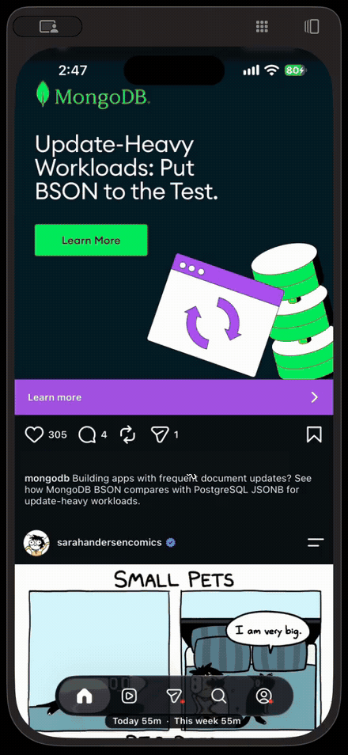
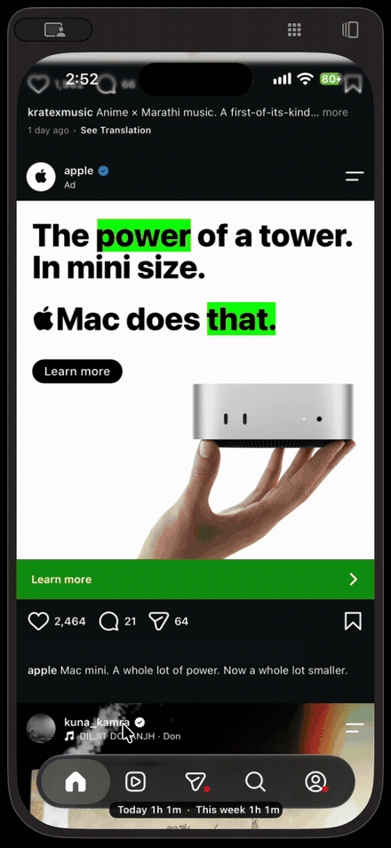
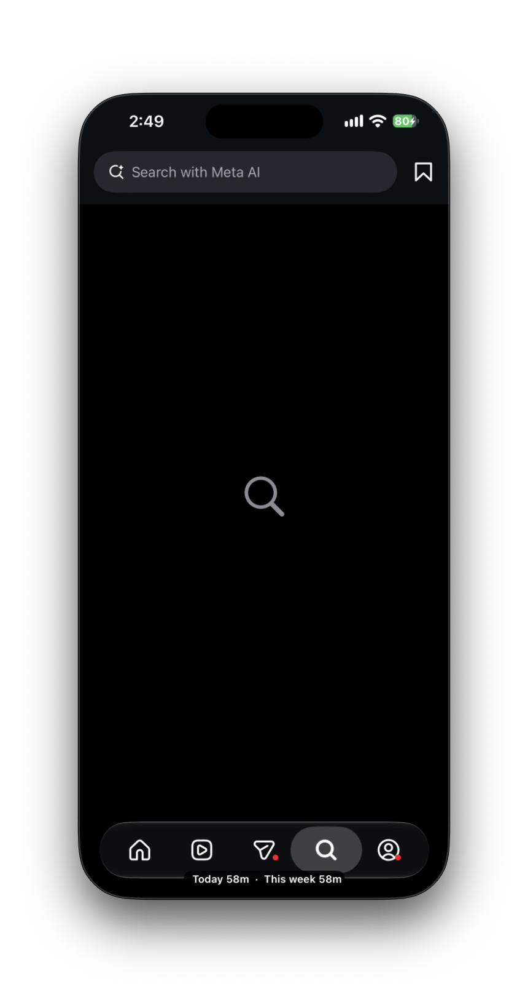

# NotTheInstagram

**Instagram, with friction added to the endless parts.**

I can't delete Instagram. My friends are there and memes get sent on DM. But I kept looking up and realizing an hour was gone. So I built an iOS framework that gets injected into Instagram and makes the infinite parts slow and a little boring. DMs, posts, stories and search keep working.

> 📝 **The story behind it:** [I used an AI agent to make my Instagram boring](https://rationalkunal.in/writing/make-instagram-boring-with-an-ai-agent/)

<table align="center">
  <tr>
    <td align="center"><br><sub>Home feed, 3 posts at a time</sub></td>
    <td align="center"><br><sub>Reels tab opens on a pause</sub></td>
    <td align="center"><br><sub>Explore without the reel grid</sub></td>
  </tr>
</table>

## What it changes

| Where | What happens |
| --- | --- |
| Home feed | Shows 3 posts, then waits. 8 seconds, then 11, then 14. |
| Explore | The reel grid is replaced by a magnifying glass. Search still works. |
| Reels tab | Opens on a pause screen. After 2 minutes, a "Continue for this session" button shows up. |
| Reels | Each reel waits before playing: 3 seconds, plus half a second for every reel after. |
| Reels from DMs | Play alone. No swiping into the next one. |
| Usage label | A small label at the bottom shows time spent today and this week. |

It also fixes login for the sideloaded copy, skips the TestFlight "update available" screen, and includes [FLEX](https://github.com/FLEXTool/FLEX) for poking around (three-finger double tap, or hold the usage label for a second).

## How it works

[Sideloadly](https://sideloadly.io/) adds the framework to a decrypted Instagram IPA and installs it on the iPhone. When Instagram launches, the framework hooks a few of Instagram's Objective-C methods and changes only the part it cares about.

Every hook checks the method's exact signature before replacing anything. If an Instagram update changes a method, that one feature turns off and the app keeps working.

The classes were found with FLEX (what is on screen) and [Hopper](https://www.hopperapp.com/) (what is in the binary). An AI coding agent did most of the digging. Its notes live in [`agents/`](agents/), and [`AGENTS.md`](AGENTS.md) tells any agent how to work in this repo.

## Try it yourself

You need a Mac with Xcode, an iPhone (iOS 15+), an Apple account, [Sideloadly](https://sideloadly.io/), and a decrypted Instagram IPA. I can't share the IPA. Everything was tested on **Instagram 455.0.0**, on an iPhone 15 with iOS 27.0.1.

1. Clone and build the framework:

   ```bash
   git clone https://github.com/rational-kunal/NotTheInstagram.git
   ```

   ```bash
   cd NotTheInstagram && ./scripts/build-framework.sh
   ```

   The framework lands in `latest-framework/NotTheInstagramFrameworkCode.framework`.

2. In Sideloadly, pick your IPA and open **Advanced Options**. Under **Tweak Injection**, tick **Inject dylibs/frameworks**, click **+framework** and add the built framework. Then hit **Start**.

3. Open Instagram and log in once. It should stay logged in after that.

Want to change something? Open the repo in your coding agent and ask. Each feature lives in its own file under `Features/`, so a new one is mostly: find the class with FLEX, find the method in Hopper, write the hook.

> ⚠️ Instagram doesn't allow modified clients. Try this on an account you are okay experimenting with.

## ⭐ Like it?

If you find this fun or useful, a star helps other people find it. It would also make my day.

## Want something changed in Instagram?

You don't need to be technical. [Open an issue](https://github.com/rational-kunal/NotTheInstagram/issues/new/choose) and describe what you want Instagram to do, or stop doing, in plain English. Or add it to [What would you change in Instagram?](https://github.com/rational-kunal/NotTheInstagram/discussions/1)

A few ideas already on my list: [hide like counts](https://github.com/rational-kunal/NotTheInstagram/issues/2), [turn the app grayscale after 30 minutes](https://github.com/rational-kunal/NotTheInstagram/issues/3), [hide "Suggested for you" posts](https://github.com/rational-kunal/NotTheInstagram/issues/4). If your idea is interesting, I'll try building it. Pull requests are welcome too. The grayscale one is a good first one, since it doesn't touch Instagram's own classes.

---

<sub>A personal project, built for fun and learning.</sub>
